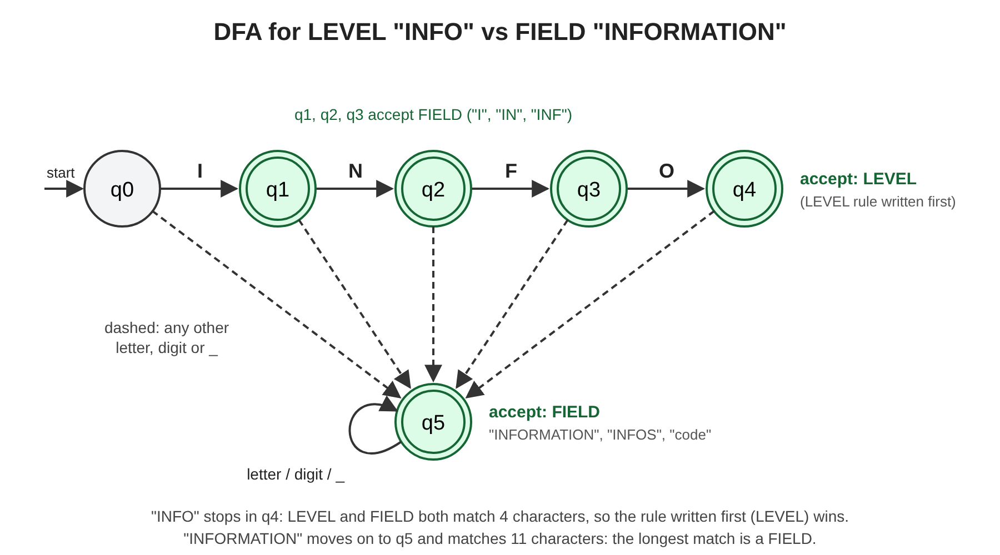
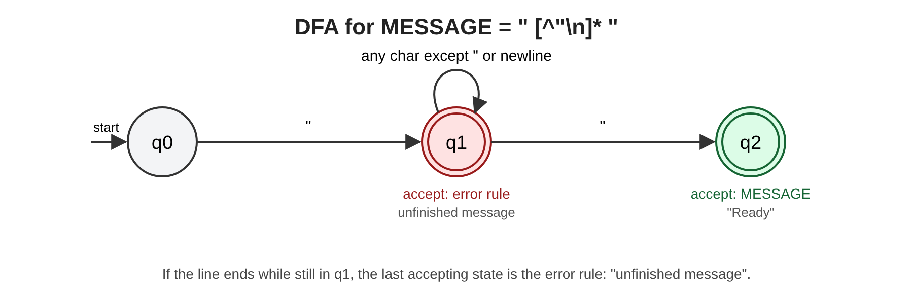

# JFlex Log Format Scanner

A lexical analyzer, generated by **JFlex**, for a small declared log format.
It reads log lines such as

```
2026-11-02 08:15:00 [WARN] disk=91 message="Disk almost full"
```

and lists every token with its **line and column (both counted from 1)**.
It only recognizes tokens. It does not interpret the log or check that the parts
come in the right order.

```
$ echo '[INFO] code=200 message="Ready"' | java -cp build LogScan
LINE:COL TYPE       LEXEME
  1:1   LBRACKET   [
  1:2   LEVEL      INFO
  1:6   RBRACKET   ]
  1:8   FIELD      code
  1:12  ASSIGN     =
  1:13  INTEGER    200
  1:17  FIELD      message
  1:24  ASSIGN     =
  1:25  MESSAGE    "Ready"
  2:1   EOF
9 token(s), 0 error(s)
```

## The declared log format

```
timestamp [LEVEL] field=value field=value ...
```

| Part | Shape | Example |
|---|---|---|
| timestamp (optional) | `YYYY-MM-DD hh:mm:ss` | `2026-11-02 08:15:00` |
| level | `DEBUG`, `INFO`, `WARN` or `ERROR` inside `[ ]` | `[INFO]` |
| field | letter or `_`, then letters, digits, `_` | `code`, `user_id` |
| value | integer or quoted message on one line | `200`, `"Ready"` |

**Out of scope:** checking that a date is a real calendar date (only its shape is
checked), escaped quotes inside messages, messages over several lines, negative or
decimal numbers, and checking the order of the parts (that is a parser's job).

## Files

| File | What it is |
|---|---|
| `src/LogScanner.flex` | **The JFlex specification** (macros, rules, competing rules) |
| `src/Lexer.java` | Generated by JFlex from the spec (do not edit by hand) |
| `src/Token.java`, `src/TokenType.java` | Token object (type, lexeme, line, column) |
| `src/LogScan.java` | `main`: scans a file, piped input, or lines you type |
| `tests/*.txt` / `tests/*.expected` | 15 test inputs and their expected output |
| `build.sh`, `run_tests.sh` | Build and test scripts |
| `docs/*.svg` / `docs/*.png` | DFA diagrams, ready for slides |

## Install (macOS)

```sh
brew install jflex          # the JFlex generator (also installs a Java runtime)
brew install openjdk        # only if `javac -version` says it is not found
jflex --version             # should print "This is JFlex 1.9.x"
```

## Build and run

```sh
cd jflex-log-scanner

# 1. Generate the lexer from the spec   (creates src/Lexer.java)
jflex -d src src/LogScanner.flex

# 2. Compile everything into build/
mkdir -p build
javac -d build src/*.java

# 3. Run it
java -cp build LogScan                       # interactive: type log lines, 'quit' to exit
java -cp build LogScan tests/05_normal_log_file.txt   # scan a file
```

`sh build.sh` does steps 1 and 2 in one go.

## Run the tests

```sh
sh run_tests.sh
```

Expected result: `15 passed, 0 failed`.

| # | Category | Input | What it shows |
|---|---|---|---|
| 01 | normal | `[INFO] code=200 message="Ready"` | the sample input from the brief |
| 02 | normal | timestamp + `[WARN] disk=91 message="..."` | a full log line |
| 03 | normal | one line per level | DEBUG, INFO, WARN, ERROR |
| 04 | normal | `code=500 retry=3 user="hong" ...` | many fields on one line |
| 05 | normal | 3-line log file | line numbers go 1, 2, 3 |
| 06 | normal | `message=""` | empty message |
| 07 | boundary | `[INFO] [INFORMATION] INFOS=1` | **INFO vs INFORMATION** |
| 08 | boundary | `year=2026 2026-11-02 23:59:59` | integer vs timestamp |
| 09 | boundary | `code=0 size=000042` | zero and leading zeros |
| 10 | boundary | `message="[x] a=1 @home #2"` | symbols inside quotes stay one MESSAGE |
| 11 | boundary | only spaces, tabs and newlines | no tokens, just EOF |
| 12 | invalid | `message="Disk full` | **unfinished message** |
| 13 | invalid | `user@host` | unexpected character `@` |
| 14 | invalid | `2026-11-02 [INFO]` | incomplete timestamp (no time) |
| 15 | invalid | unfinished message, then a good line | the scanner recovers on the next line |

## How it works

### 1. Tokens (8 types, plus ERROR and EOF)

| Token | JFlex pattern | Example |
|---|---|---|
| TIMESTAMP | `{DIGIT}{4} "-" {DIGIT}{2} "-" {DIGIT}{2} " " {DIGIT}{2} ":" {DIGIT}{2} ":" {DIGIT}{2}` | `2026-11-02 08:15:00` |
| LEVEL | `"DEBUG" \| "INFO" \| "WARN" \| "ERROR"` | `INFO` |
| FIELD | `[a-zA-Z_] [a-zA-Z_0-9]*` | `message` |
| ASSIGN | `"="` | `=` |
| INTEGER | `{DIGIT}+` | `200` |
| MESSAGE | `\" [^\"\r\n]* \"` | `"Ready"` |
| LBRACKET, RBRACKET | `"["`, `"]"` | `[`, `]` |

Spaces, tabs and newlines are skipped. Errors come back as `ERROR` tokens with a
message, so the scanner reports the problem and **keeps going**.

### 2. Competing rules

JFlex settles conflicts in two ways: it takes the **longest match** first, and if two
rules match the same length, the **rule written first** wins.

1. **INFO vs INFORMATION** (rule order + longest match). `INFO` matches both the LEVEL
   rule and the FIELD rule with 4 characters, so the LEVEL rule is written first and
   wins. `INFORMATION` matches FIELD with 11 characters, which is longer, so it is a
   FIELD (test 07).
2. **Finished vs unfinished message** (longest match). `"Ready"` matches the MESSAGE
   rule including the closing quote, one character longer than the unfinished-message
   error rule, so MESSAGE wins. With no closing quote on the line, only the error rule
   matches (tests 12 and 15).
3. **Timestamp vs integer** (longest match). `2026-11-02 08:15:00` is one TIMESTAMP,
   not INTEGER `2026` followed by other symbols (test 08). A date with no time matches
   an error rule instead (test 14).

### 3. DFA diagrams

JFlex turns the regular expressions into an NFA, converts it to a DFA and minimizes
it. For this spec it reports **51 DFA states before minimization and 44 after**.
The diagrams below are the parts of that DFA that decide the competing rules
(simplified: they leave out the other levels and symbols).

**INFO vs INFORMATION**



**Finished vs unfinished message**



On `"Disk full` followed by the end of the line, the scanner is stuck in q1 with no
closing quote. The last accepting state it passed is the error rule, so it reports
`unfinished message "Disk full (missing closing ")` at the column of the opening quote.
